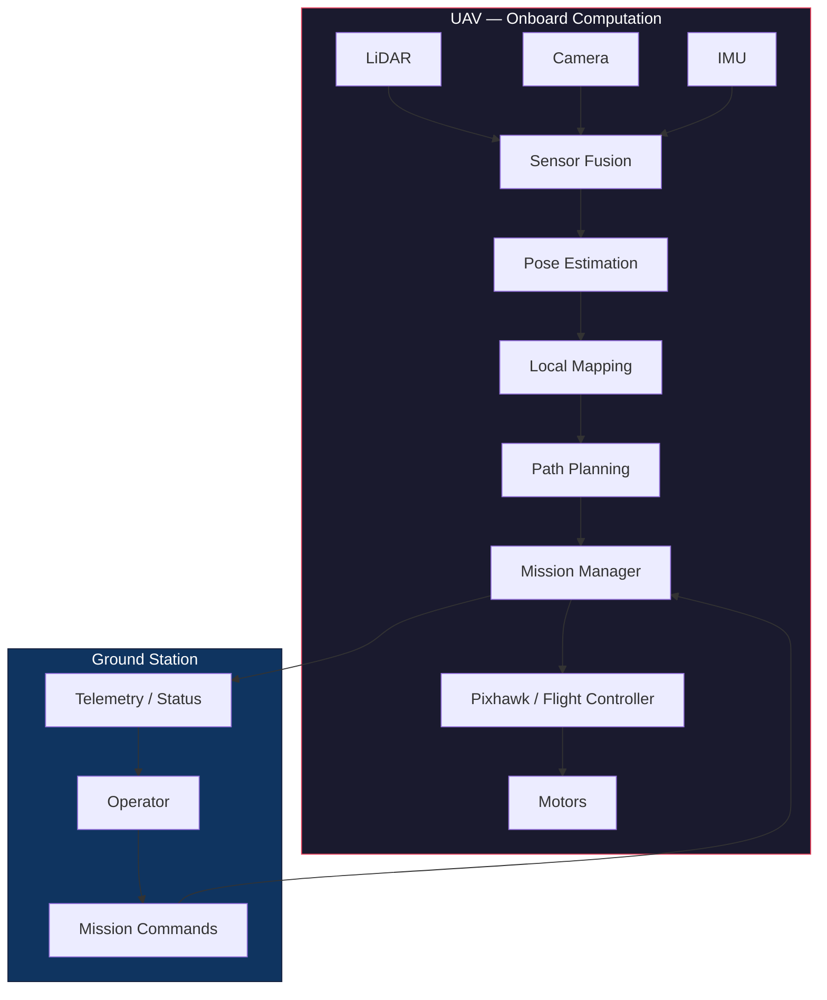

# IRoC-U Autonomous Navigation

**Autonomous UAV Navigation in GPS/GNSS-Denied Environments**

A systematic engineering investigation for the ISRO Robotics Challenge – URSC (IRoC-U).

> **This repository is simultaneously an engineering record, research notebook, experiment framework, and decision log.**
> Every claim is backed by measurement. Every assumption is explicitly marked. Every failed experiment is documented.

---

## Current Phase

```
╔══════════════════════════════════════════════════════════════╗
║  PHASE 1 — SENSOR AND COMPUTATIONAL FEASIBILITY             ║
║  Status: IN PROGRESS                                         ║
║  Started: 2026-10-07                                         ║
╚══════════════════════════════════════════════════════════════╝
```

**Objective:** Prove, using publicly available sensor datasets and reproducible experiments, that our proposed LiDAR/camera/IMU navigation architecture is computationally and technically feasible — and determine what hardware specifications we actually need.

---

## Project Goal

Build an autonomous micro-UAV (< 2 kg) capable of:

1. Departing from a base station
2. Autonomously navigating a search area **without GPS/GNSS**
3. Identifying and surveying targets
4. Returning to the base station
5. Performing autonomous landing

The core technical challenge is **GPS/GNSS-denied autonomous navigation** using onboard sensors and computation.

---

## Why This Project Exists

Our Director has challenged us:

> *"Don't tell me you think you need a LiDAR. Show me you measured X, Y, and Z — therefore you require a sensor and computer with these specifications."*

**We cannot purchase hardware based on assumptions.** This repository exists to produce the evidence that justifies every hardware decision. Phase 1 answers the question: *Can we prove feasibility before spending money?*

---

## Current Architecture



> **CRITICAL DESIGN PRINCIPLE:** All autonomous navigation computation runs **onboard the UAV**. The ground station provides mission-level commands and monitoring only.

### Mission-Level vs Flight-Level Control

| Layer | Responsibility | Component |
|-------|---------------|-----------|
| **Operator** | Decides WHAT mission to perform | Human / Ground Station |
| **Mission Manager** | Translates mission into navigation goals | Onboard software |
| **Planner** | Decides HOW to accomplish goals | Onboard software |
| **Flight Controller** | Stabilization, attitude, motor control | Pixhawk / PX4 / ArduPilot |

Example mission commands: `TAKEOFF`, `SEARCH <area>`, `SURVEY <area>`, `RETURN`, `LAND`, `ABORT`, `STATUS`

---

## Current Questions

These are the questions Phase 1 must answer:

| # | Question | Status |
|---|----------|--------|
| Q1 | What LiDAR characteristics do we actually require? | OPEN |
| Q2 | Is a low-cost LiDAR sufficient for local navigation? | OPEN |
| Q3 | How much LiDAR data is generated per second/minute/hour? | OPEN |
| Q4 | How much camera data is generated? | OPEN |
| Q5 | How much computation is required for the navigation stack? | OPEN |
| Q6 | What CPU/GPU/RAM specifications are needed? | OPEN |
| Q7 | What is the end-to-end processing latency? | OPEN |
| Q8 | Can the navigation stack run onboard a UAV? | OPEN |
| Q9 | What communication bandwidth is necessary? | OPEN |
| Q10 | What information must stay onboard vs. sent to ground? | OPEN |
| Q11 | How do we issue mission commands while retaining autonomy? | OPEN |
| Q12 | What are the weight/power/thermal constraints? | OPEN |
| Q13 | What is the minimum viable sensor suite? | OPEN |
| Q14 | What evidence justifies purchasing specific hardware? | OPEN |

---

## Experiments

| ID | Experiment | Purpose | Questions Addressed | Status |
|----|------------|---------|---------------------|--------|
| EXP-01 | LiDAR Dataset Characterization | Understand LiDAR data: rates, sizes, fields, ranges | Q1, Q2, Q3, Q9 | NOT STARTED |
| EXP-02 | Camera Data Characterization | Understand camera data: resolution, rates, sizes | Q4, Q9 | NOT STARTED |
| EXP-03 | LiDAR Odometry | Test LiDAR-based pose estimation algorithms | Q5, Q6, Q7 | NOT STARTED |
| EXP-04 | Visual Odometry | Test camera-based pose estimation | Q5, Q6, Q7 | NOT STARTED |
| EXP-05 | LiDAR-Camera Fusion | Test multi-sensor fusion approaches | Q5, Q6, Q13 | NOT STARTED |
| EXP-06 | Local Mapping | Test environment representation methods | Q5, Q6 | NOT STARTED |
| EXP-07 | Localization | Test localization accuracy and robustness | Q1, Q2, Q8 | NOT STARTED |
| EXP-08 | Path Planning | Test planning algorithms | Q5, Q7 | NOT STARTED |
| EXP-09 | Compute Benchmark | Profile full pipeline on candidate hardware | Q6, Q7, Q8, Q12 | NOT STARTED |
| EXP-10 | End-to-End Latency | Measure sensor-to-actuator latency | Q7, Q8 | NOT STARTED |

---

## Hardware Status

```
╔══════════════════════════════════════════════════════════════╗
║  NO HARDWARE PURCHASE DECISION HAS BEEN MADE YET.           ║
║  Hardware selection is PENDING experimental results.         ║
╚══════════════════════════════════════════════════════════════╝
```

See: [`hardware/candidate-lidars.md`](hardware/candidate-lidars.md) and [`hardware/candidate-compute.md`](hardware/candidate-compute.md)

---

## Evidence Policy

This project distinguishes five categories of values:

| Category | Symbol | Meaning |
|----------|--------|---------|
| **Measured** | 📏 | Experimentally measured from actual data |
| **Derived** | 📐 | Mathematically calculated from measured values |
| **Assumed** | ⚠️ | Assumption — not yet validated |
| **Estimated** | 🔮 | Educated estimate based on incomplete information |
| **Pending** | ⏳ | Not yet measured — experiment required |

**Rule:** Never present an assumed value as a measured value. Never mix categories without explicit labels.

---

## Reproducibility

Every experiment in this repository follows a strict reproducibility protocol:

1. **Configuration file** (`config.yaml`) — all parameters in one place
2. **Environment recording** — OS, CPU, GPU, RAM, Python version, library versions, Git commit
3. **Dataset versioning** — exact dataset, version, download source, checksum where practical
4. **Deterministic execution** — random seeds recorded, scripts produce identical outputs
5. **Machine-readable outputs** — CSV for metrics, JSON for metadata, PNG/SVG for plots
6. **Human-readable report** — Markdown interpretation of every result

To reproduce any experiment:
```bash
# 1. Clone the repository
git clone <repo-url>
cd IROC-U

# 2. Set up Python environment
python -m venv venv
# Windows: venv\Scripts\activate
# Linux:   source venv/bin/activate
pip install -e .

# 3. Download the required dataset (see datasets/README.md)

# 4. Run the experiment
python experiments/01-lidar-characterization/scripts/characterize_lidar.py
```

---

## Project Roadmap

| Phase | Name | Status |
|-------|------|--------|
| 0 | Requirements and mission definition | COMPLETE |
| **1** | **Sensor + computational feasibility** | **IN PROGRESS** |
| 2 | Navigation algorithms | NOT STARTED |
| 3 | Simulation | NOT STARTED |
| 4 | Onboard computing selection | NOT STARTED |
| 5 | Hardware integration | NOT STARTED |
| 6 | Ground testing | NOT STARTED |
| 7 | Flight testing | NOT STARTED |
| 8 | Mission validation | NOT STARTED |
| 9 | Competition preparation | NOT STARTED |

See: [`docs/09-development-roadmap.md`](docs/09-development-roadmap.md)

---

## Repository Structure

```
IROC-U/
├── README.md                          # This file
├── LICENSE                            # MIT License
├── pyproject.toml                     # Python project configuration
├── .gitignore
│
├── docs/                              # Engineering documentation
│   ├── 00-project-overview.md
│   ├── 01-mission-requirements.md
│   ├── 02-system-architecture.md
│   ├── 03-navigation-problem.md
│   ├── 04-sensor-requirements.md
│   ├── 05-computing-requirements.md
│   ├── 06-communication-architecture.md
│   ├── 07-mission-control.md
│   ├── 08-hardware-selection.md
│   ├── 09-development-roadmap.md
│   ├── 10-risk-register.md
│   ├── decision-log.md
│   ├── assumptions.md
│   └── glossary.md
│
├── requirements/                      # System requirements
│   ├── requirements.md
│   └── traceability-matrix.md
│
├── datasets/                          # Dataset documentation
│   ├── README.md
│   └── dataset-registry.md
│
├── experiments/                       # All experiments
│   ├── README.md
│   ├── TEMPLATE.md
│   └── 01-lidar-characterization/
│       ├── README.md
│       ├── config/
│       ├── scripts/
│       ├── results/
│       └── figures/
│
├── benchmarks/                        # Hardware benchmarks
├── simulation/                        # Simulation environment
├── src/                               # Production source code
├── tools/                             # Utility scripts
├── configs/                           # Shared configuration
├── results/                           # Aggregated results
│   ├── figures/
│   ├── tables/
│   └── reports/
├── hardware/                          # Hardware evaluation
│   ├── candidate-lidars.md
│   ├── candidate-compute.md
│   └── preliminary-bom.md
├── reports/                           # Formal reports
└── logs/                              # Execution logs
```

---

## Competition Context

**ISRO Robotics Challenge – URSC (IRoC-U)**
Theme: *"Towards Swarm Expedition: Autonomous Surveyor Challenge for Exploration, Navigation and Dynamics (ASCEND)"*

Key constraints (from IRoC-U 2026 rules — **must be re-verified for our competition year**):

- UAV mass < 2 kg
- GPS/GNSS, pseudolites, reflector arrays **prohibited**
- Battery-operated only
- RF communication only
- No telemetry or remote piloting during autonomous mission
- Indigenous algorithm development required
- Emergency "call off" mode required
- Compliance with Drone Rules-2021 (or latest)

> ⚠️ **ASSUMPTION:** These rules are based on IRoC-U 2026. Rules for subsequent competition years must be verified independently. See [`docs/assumptions.md`](docs/assumptions.md).

---

## Team & Contact

*To be updated with team member information.*

---

## License

[MIT License](LICENSE)
